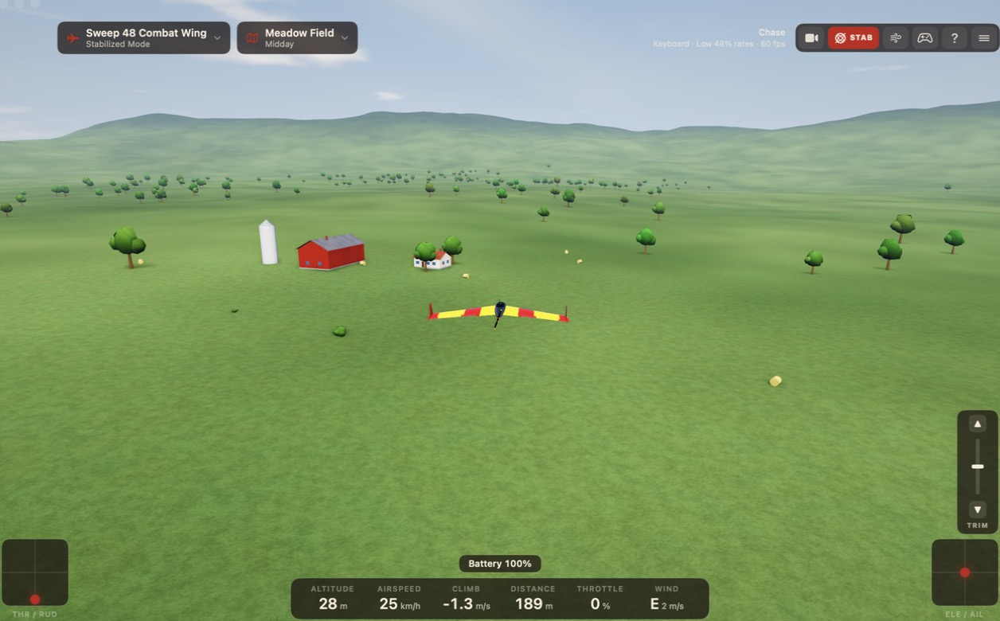
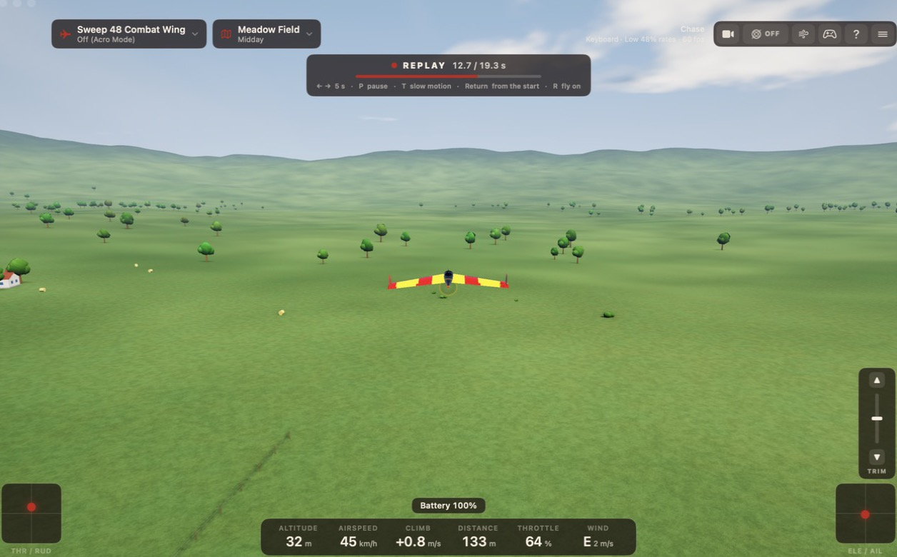
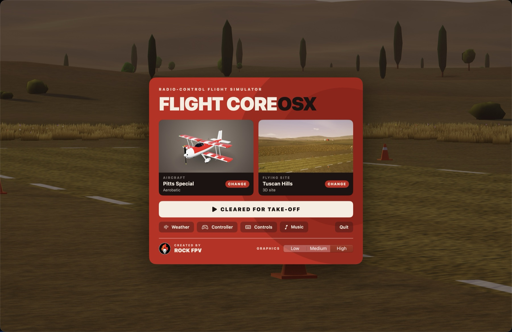
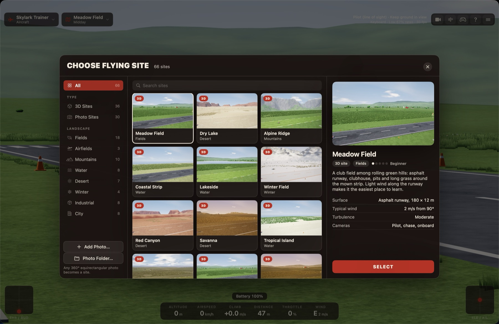
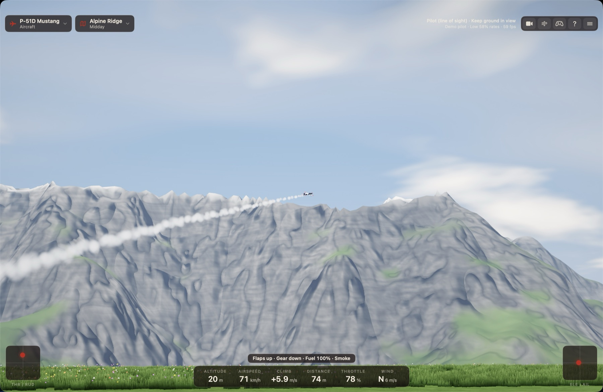
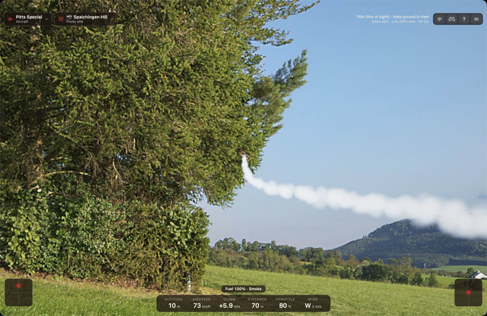
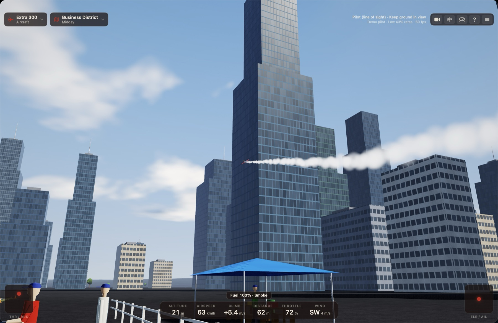
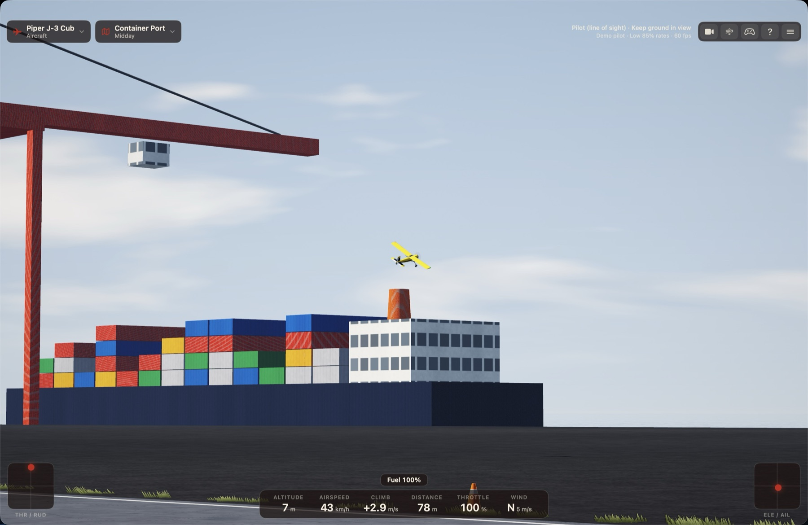
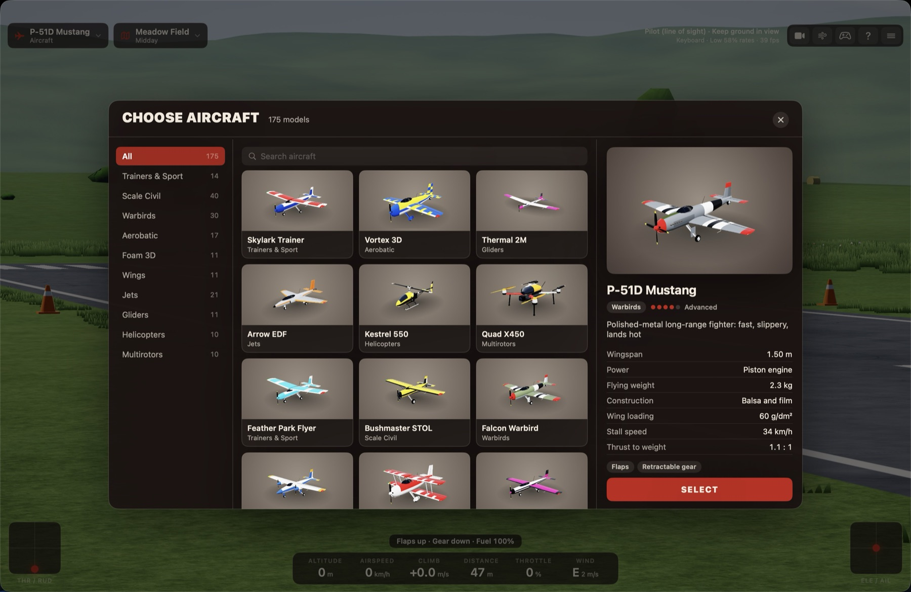
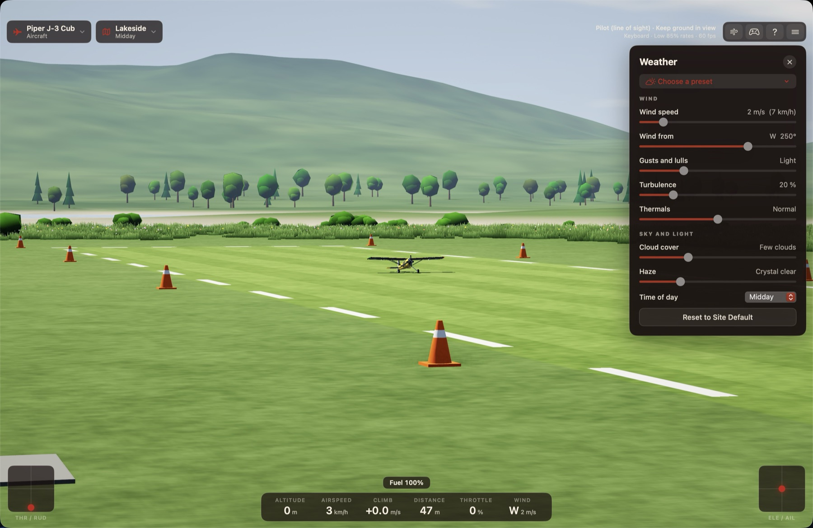

# FlightCore OSX

A RC Flight Simulator for macOS, written in Swift and rendered with Metal. Created by Rock FPV.


You stand at the edge of the field and fly the model from the pilot's point of view, the way you would at a real flying site. It has 175 aircraft, 36 3D flying sites, support for 360° photo sites, and works with USB RC transmitters, gamepads and the keyboard. Some features of commercial simulators are missing; see [Not yet implemented](#not-yet-implemented).

## New in 2.0

- **Gyro for every aircraft**, on a button in the top bar: off, AS3X or stabilized for airplanes; off or stabilized for helicopters and multirotors. See [Gyro](#gyro).
- **Flight replay** with your stick movements, seeking and slow motion. See [Replay](#replay).
- **Steadier hovers and torque rolls:** propellers now have a normal force, and the 3D foamies have zero incidence and deeper rudders.
- **Pitch trim** with a gauge on the display, and corrected thrust lines so opening the throttle no longer pitches the nose up.
- **Hand launch** on Space, with a launch assist.
- **Less lag:** a USB transmitter's sticks reach the screen sooner. Menus and browsers are quicker, and sound is protected against dropping out.

Coming from 1.4: **every aircraft now starts with the gyro off**, so helicopters and multirotors no longer level themselves until you switch it on (F), and **R now plays the replay**; Space resets.

## Screenshots

| | |
|---|---|
|  |  |
| A flying wing in Stabilized Mode, with the gyro button in the top bar | The replay: timeline, keys and the recorded stick positions |
|  |  |
| The main menu: aircraft, flying site, weather, controller, music and graphics | The site browser: 36 3D sites and 30 photo sites, by type and landscape |
|  |  |
| A P-51 climbing out at Alpine Ridge, seen from the pilot's position | A Pitts Special at a 360° photo site, Spaichingen Hill |
|  |  |
| An Extra 300 among the towers of Business District | A Piper Cub over a container ship at Container Port |
|  |  |
| The aircraft browser: 175 models with previews and key figures | The weather panel, at Lakeside |

## Download

Get the app from the [latest release](https://github.com/lydianb79/FlightCoreOSX/releases/latest), unzip it and move `FlightCore.app` to your Applications folder. There is one download for each kind of Mac, with the version in its name:

- `FlightCore-OSX-2.0.0-arm64.zip` for Apple silicon Macs (M1 and later)
- `FlightCore-OSX-2.0.0-x86_64.zip` for Intel Macs

Not sure which you have? Choose **Apple menu ▸ About This Mac**: "Chip: Apple M…" means Apple silicon, "Processor: Intel…" means Intel.

The app is not signed with an Apple developer certificate or notarised, so macOS will refuse to open it the first time. Either right-click the app, choose **Open**, and confirm (on recent macOS versions: try to open it once, then allow it under **System Settings ▸ Privacy & Security**), or clear the download flag in Terminal:

```bash
xattr -dr com.apple.quarantine /Applications/FlightCore.app
```

Both need macOS 13 or later. The Intel build has been tested on an Apple silicon Mac under Rosetta, not on Intel hardware.

The app itself is only a few megabytes, because aircraft, scenery and sound are generated by code. An optional `FlightCore-Panoramas.zip` on the same page adds the thirty photo sites; see [Photo sites](#photo-sites). This page describes version 2.0.0.

## Build from source

Requirements: macOS 13 or later, a Mac with Metal support, and Xcode 15 or later (or the Swift 5.9+ command-line toolchain).

Build the app bundle:

```bash
./build_app.sh
```

Then launch it:

```bash
open FlightCore.app
```

`./build_release.sh` builds both release downloads (Apple silicon and Intel) into `dist/`; the version number is set at the top of `build_app.sh`.

To work on the code, open `Package.swift` in Xcode, or run it directly from the command line with `swift run -c release`.

## Interface

- **Splash screen** at launch: the artwork flies in and settles, a band of light sweeps across it, and it gives way to the main menu. Any key or click continues, or it moves on by itself after a few seconds.
- **Menu music** starts with the splash screen and plays in the main menu and the browsers. It fades out when you are cleared for take-off and fades back in when you return to the menu. The Music button in the main menu (or Simulation ▸ Menu Music On / Off) turns it off.
- **Main menu** (Esc): shows the current aircraft and flying site with previews, starts the flight, and sets the graphics quality.
- **Aircraft browser** (Tab, or click the aircraft name): category list, search, a rendered preview of every model, and a detail panel with description, difficulty and key figures, including what powers the model: a brushless electric motor, an electric ducted fan, a piston engine or a turboprop. **Select** takes the aircraft and returns to the main menu.
- **Site browser** (click the site name): filters by type and landscape, search, and a preview, description, difficulty and conditions for each 3D and photo site, plus a button to add your own panorama. **Select** takes the site and returns to the main menu.
- **Weather panel** (wind button in the top bar, or Weather in the main menu): presets from Calm to Stormy; wind speed and direction, gusts and lulls, turbulence and thermal strength; cloud cover, haze and six times of day from dawn to dusk on 3D sites; and on photo sites a light grade toward golden evening or dusk. Everything applies live.
- Weather and Controls opened from the main menu return to it; the flight only starts with **Cleared for take-off**.
- **In flight:** a top bar with the current aircraft and site and buttons for the FPV camera, the gyro, weather, controller setup, help and the menu (the same on 3D and photo sites; on photo sites the camera button is dimmed, as they have only the pilot's view), and a telemetry strip with altitude, airspeed, climb, distance, throttle and wind. Press V to hide it.

A new site is loaded in the background, so the menus stay responsive: a 3D site is ready in about a tenth of a second, a photo site in about half a second. While a menu or browser is open the frozen scene behind it is redrawn only a few times a second, and the aircraft pictures are prepared in the meantime and kept on disk, so the browsers never wait for them.

The last aircraft and site are remembered between launches, and both browsers reopen on the category or filter you last used. The interface uses the red, cream and black of the splash artwork.

## Aircraft

One hundred and seventy-five aircraft, grouped by category in the aircraft browser and the Aircraft menu. Step through them with `[` and `]`.

| Category | Count | Examples |
|---|---|---|
| Trainers & Sport | 14 | Skylark Trainer, Cadet 1200, Stick 40, Tundra Trainer, Stiletto Racer, Pathfinder 1.5, Bandit 50, Gemini Twin Trainer |
| Scale Civil | 40 | Piper J-3 Cub, Cessna 172, Pilatus PC-6 Porter, Pilatus PC-12, DHC-2 Beaver, Cirrus SR22, DHC-6 Twin Otter, Douglas DC-3, Antonov An-2, Tiger Moth, and three floatplanes, Aviat Husky, Cessna 185, Mooney M20, Van's RV-8, Islander, ATR 72, Air Tractor AT-802 |
| Warbirds | 30 | P-51D Mustang, Spitfire, Bf 109, Fw 190, Hurricane, P-47, Zero, Sea Fury, Mosquito, T-6 Texan, Sopwith Camel, F4U Corsair, P-38 Lightning, Ju 87 Stuka, Tempest, B-25 Mitchell, Fokker D.VII |
| Aerobatic | 17 | Extra 300, Edge 540, Sukhoi Su-26, Yak-54, CAP 232, Pitts Special, Pilatus PC-7, Extra 330SC, MXS, Sbach 342, Laser, Bücker Jungmeister |
| Foam 3D | 11 | Flatty 3D, F3P Indoor Aerobat, Slick 3D Profile, Foam Extra XL, Micro Flatty, Shock Flyer 800, Sbach 3D Foamy |
| Wings | 11 | Sweep 48 Combat Wing, Plank 1.5 Soarer, Delta Dart, Voyager 2.1 FPV Wing, Race Wing 600, Mini Combat Wing 800, Slope Racer 60, Thermal Wing 2.4, Twin Trekker 1.3, Micro Delta 420, Speed Arrow 900 |
| Jets | 21 | F-16, F-86 Sabre, MiG-15, F-104 Starfighter, BAe Hawk, L-39 Albatros, T-33, F-5 Tiger, F-15 Eagle, A-10, Hawker Hunter, Alpha Jet, Citation CJ, and five tailless jets: Horten Ho 229, B-2 Spirit, Avro Vulcan, Mirage III, Me 163 Komet |
| Gliders | 11 | ASK 21, ASW 28, DG-1000, Discus, Ka 8, Thermal 2M, ASH 31, Ventus, SGS 2-33 |
| Helicopters | 10 | Kestrel 550, Sparrow 450, Condor 700, Gnat 150, Swift 380, Talon 500, Fury 600 3D, Raven 770 Speed, Bell 206 JetRanger, MD 500E |
| Multirotors | 10 | Quad X450, Wasp Racing Quad, Apex 5 Racer, Freestyle 5 HD, Tiny Whoop 65, Whoop 75 Brushless, Cinewhoop 3, Toothpick 3, Long Range 7, Hexa 680 Lifter |

Every aircraft has its own flight model: the physics and the 3D shape are both generated from the same set of numbers (span, chords, mass, thrust, tail sizes, control throws, gear). The scale models are approximations: proportions, engine layout, gear and colours follow the real aircraft, but shapes such as elliptical or gull wings are simplified and there are no national markings. Most were derived by scaling a handful of tested base designs, so aircraft of the same family handle more alike than the real ones would. The Foam 3D planes are flat-plate "profile" airframes with oversized control surfaces and more thrust than weight.

## Flying sites

The site browser filters by type (3D or photo) and by landscape (Fields, Airfields, Mountains, Water, Desert, Winter, Industrial, City), with search, previews, a difficulty rating and a description for each site.

### 3D sites

| Site | Landscape | Notes |
|---|---|---|
| Meadow Field | Fields | Asphalt runway among green hills; the easiest place to learn |
| Tuscan Hills | Fields | Grass strip among golden hills with cypress and olive trees |
| Forest Clearing | Fields | Short strip hemmed in by tall forest |
| Regional Airport | Airfields | 520 m runway, hangars, apron and control tower |
| Alpine Ridge | Mountains | Ridge-top strip with strong slope lift |
| Highland Moor | Mountains | Treeless, windy and overcast, with dark lochs |
| Coastal Strip | Water | Runway behind the dunes, sea in front |
| Lakeside | Water | Grass strip beside a wooded lake |
| Tropical Island | Water | Sand strip among palms, lagoon all round |
| Dry Lake | Desert | Wide dirt strip on a playa |
| Red Canyon | Desert | Mesa-top strip beside a deep canyon |
| Savanna | Desert | Golden grassland with acacias and strong thermals |
| Winter Field | Winter | Packed-snow strip under high peaks |
| Autumn Valley | Fields | Mown strip in a wooded valley in autumn colour |
| Lava Fields | Mountains | Cinder strip on a black lava plain under a volcano |
| Fjord | Water | Grass shelf above deep water between rock walls |
| Wetlands | Water | Dry rise in a reed marsh laced with channels and pools |
| Sea Cliffs | Water | Clifftop strip seventy metres above the sea; strong slope lift |
| Salt Flats | Desert | 400 m strip on a dead-flat white salt pan |
| Sand Sea | Desert | Packed-sand strip between great dunes |
| Freight Yard | Industrial | Paved loading strip between warehouses and container stacks |
| Container Port | Industrial | Quayside apron under gantry cranes, harbour basin in front |
| Power Station | Industrial | Rough grass below cooling towers, chimneys and pylon lines |
| Steelworks | Industrial | Cinder strip beside mill halls and banded chimneys, in evening light |
| Refinery | Industrial | Dirt strip in dry country beside tank farms and silver columns |
| Quarry | Industrial | Level floor of a stone quarry ringed by rock benches |
| Logistics Park | Industrial | Huge asphalt lorry park between flat-roofed sheds; room for jets |
| Old Brickworks | Industrial | Overgrown yard among derelict brick halls and old chimneys |
| City Park | City | The great lawn of a park, with the city on every side |
| Riverside | City | River-bank meadows facing the city across the water |
| Stadium Car Park | City | Empty match-day car park beside a football stadium |
| Suburb Green | City | Playing field hemmed in by rows of houses |
| Harbour Promenade | City | Waterfront with open harbour in front and the city behind |
| Cathedral Meadow | City | Hay meadow below an old town of red roofs and a spire |
| Skyline | City | Open ground facing the downtown towers at sunset |
| Business District | City | Vacant lot walled in by office blocks and towers; gusty |

The industrial and city sites are built up: warehouses, factories, tanks, chimneys, cooling towers, cranes, ships, houses, flats, offices and glass towers stand round the field. Buildings are solid, they shelter the wind and leave rough air behind them, and their windows light up as the sun goes down. The flying field, the area in front of the pilot and the demo pilot's circuit are kept clear.

Wind, gusts, turbulence, thermals, cloud cover, haze and time of day are set from the Weather panel. An aircraft that comes down in water is lost.

### Photo sites

Any 360° equirectangular panorama (2:1 aspect ratio; JPG, PNG, HEIC or TIFF) can be used as a flying site.

- **Flying Site ▸ Choose Panoramas Folder…** points FlightCore at any folder of photos, including one level of folders inside it. **Use the Default Panoramas Folder** goes back.
- **Flying Site ▸ Add 360° Panorama Photo…** (⌘O) copies single photos into the folder in use, and **Show Panoramas Folder** opens it. Without a chosen folder that is `~/Library/Application Support/FlightCore/Panoramas`, which is always searched as well.
- The sun direction and ambient light are estimated from the photo, so the model is lit to match and casts a shadow on the photographed ground.
- The **Photo:** items in the Flying Site menu rotate the panorama, shift its horizon and set the camera height. The settings are saved in a `.json` file next to the image.
- A photo taken on a hillside can have sloping ground: `"slope"` (degrees) and `"uphill"` (the bearing in the photo that the ground rises toward) in the `.json` file. On a slope the model is held until you open the throttle.
- **Photo: Show / Hide Obstacles** draws the invisible ground as rings at 5, 10, 20 … 320 m together with the solid obstacles, to check them against the photo. `FlightCore --panocheck <folder>` writes the same overlay for every photo as an image, `FlightCore --panocrop <out.jpg> <name> <from> <to>` draws a close-up of a range of bearings with labelled distances, `FlightCore --obstaclelist` lists how near the closest obstacle is at every site, and `FlightCore --parktest` checks that the model sits still on the ground at every photo site.

Photos are shown as they are, without added sharpening; `FlightCore --panostats` lists how much real detail each one holds, which helps to pick sharp ones.

No photos are included in the app or in this repository, to keep both small. The thirty photos that have presets are a separate download on the [release page](https://github.com/lydianb79/FlightCoreOSX/releases/latest): get `FlightCore-Panoramas.zip` (1.3 GB) and unzip it wherever you like to keep it. Then start FlightCore, choose **Flying Site ▸ Choose Panoramas Folder…** (or **Photo Folder…** in the site browser) and pick the unzipped folder. The photo sites appear at once and the choice is remembered. It does not matter where the app itself is kept. They are CC0 panoramas from [Poly Haven](https://polyhaven.com/hdris), which has many more; download the tone-mapped JPG version.

Thirty Poly Haven panoramas have built-in presets (name, description, rotation, start point, take-off direction, wind, ambience and, where the photo calls for it, obstacles and sloping ground) that apply automatically when the file keeps its original name: `alps_field`, `autumn_field`, `belfast_open_field`, `derelict_airfield_01`, `derelict_airfield_02`, `dry_cracked_lake`, `dreifaltigkeitsberg`, `immenstadter_horn`, `hausdorf_meadow`, `lago_disola`, `camdeboo_road`, `golden_gate_hills`, `evening_meadow`, `steinbach_field`, `stierberg_sunrise`, `countrytrax_midday`, `spaichingen_hill`, `dry_hay_field`, `farm_field`, `goegap_road`, `grasslands_sunset`, `hochsal_field`, `horn-koppe_spring`, `limpopo_golf_course`, `poolbeg`, `rural_asphalt_road`, `snow_field`, `snowy_hillside_02`, `suburban_football_field` and `wildflower_field`.

The site list keeps a small preview of every photo in the caches folder and makes missing ones in the background, so it opens at once.

For your own photos, the `.json` file next to the image can also set where aircraft start and add obstacles — upright cylinders standing in for photographed trees and buildings, which the aircraft crashes into:

```json
{
  "startX": -20, "startZ": -15, "startHeading": 90,
  "obstacles": [ { "bearing": -52, "distance": 30, "radius": 5, "height": 13 } ]
}
```

`bearing` is measured in the photo (0° at the image centre, positive to the right). Collisions on a photo site are worked out from the photo itself:

- **Direction, outline and height** come from the picture: FlightCore works out which parts of the photo are open sky and which hold something. Gaps between crowns, the sky beside a pointed treetop and the air above a hedge are open.
- **Distance** is measured where the object's foot meets the ground. The ground is a known plane and the camera's height above it is known, so the angle below the horizon at which a tree trunk or a wall meets the grass gives how far away it stands. A lone tree is as deep as it is wide; a wood or a row of houses has no far side.
- **Where** to measure comes from the preset's obstacles: they mark the directions in which something near really stands. Elsewhere a change of colour in the ground (a field boundary, a track, the lip of a gully) could be mistaken for a foot, and a crash in open air is the worst mistake. If the foot cannot be made out, or the measurement disagrees wildly with the preset, the preset's distance is used.

The model has hit something when, seen from the camera, it is in front of it, has reached its distance and has not passed its far side. **Photo: Show / Hide Obstacles** draws the result as walls: cyan where the distance was measured, orange where it comes from the preset. `FlightCore --depthcheck <folder>` writes each photo with the foot line and the distances marked, and `FlightCore --collisiontest` flies out in 72 directions at every photo site and checks that nothing stops the model in open air. (`FlightCore --maskcheck <folder>` writes each photo with the solid parts tinted.) The built-in presets place obstacles on the far side of what the photo allows, because a crash in what looks like open air is worse than a near miss.

The ground of a photo site is an invisible plane, level or tilted to match a hillside, that only receives the model's shadow; humps and hollows in the photo are not followed. Photo sites use the pilot camera only. Photos taken on level or evenly sloping ground work best; a summit or a ledge above a valley does not, because the model then meets the invisible ground in what looks like mid-air. The aircraft is always drawn in front of the photo, so it never disappears behind a photographed object.

## Controls

Press **H** in the app for this list.

| Key | Action |
|---|---|
| ← → | Aileron (roll) |
| ↑ ↓ | Elevator (↓ pulls up) |
| A / D | Rudder (yaw) |
| W / S | Throttle or collective up / down |
| X | Throttle cut |
| Q | Wheel brakes |
| Shift | Full stick deflection |
| Space | Launch a model held in the hand (wings, gliders and other models without wheels); otherwise reset the aircraft. Return also launches |
| R | Replay the flight; R again (or Esc) to fly on |
| `[` `]`, 1–9 | Previous / next aircraft, or pick one |
| N | Next flying site |
| C | Camera: pilot, chase, onboard |
| F8 | FPV (onboard camera) / back to the view from outside; also a button in the top bar. 3D sites only |
| Z | Zoom: auto, keep ground in view, fixed |
| F | Gyro: off, on (AS3X), stabilized for airplanes; off, on (stabilized) for helicopters and multirotors. Also a button in the top bar |
| I | Helicopter rotor speed: low, normal, high |
| L | High / low rates |
| `-` `=` | Pitch trim: nose down / nose up, one click at a time (hold to repeat) |
| 0 | Centre the pitch trim |
| E | Flaps: up, half, full (aircraft that have them) |
| G | Landing gear up / down (aircraft with retractable gear) |
| Y | Smoke on / off |
| U | Helicopter throttle hold (autorotation) |
| P | Pause |
| T | Slow motion |
| , / . | Less / more wind |
| B | Balloon Burst challenge |
| K | Demo pilot on / off |
| M | Mute sound |
| V | Hide / show the in-flight display |
| H | Controls list |
| Tab | Aircraft browser |
| Esc | Main menu |
| ⌃⌘F | Full screen / window |

The pitch trim also has a gauge at the bottom right of the display. It stands upright like the elevator trim lever on a transmitter: the upper arrow trims nose down (as pushing the stick forward), the lower one nose up, and the marker sits above the centre when the trim is nose down. Double-click the gauge to centre it.

### Gyro

The gyro button in the top bar, **F**, or an assigned switch steps through the settings. Every aircraft starts with the gyro off when it is chosen; a reset keeps the setting.

| Setting | Airplanes | Helicopters and multirotors |
|---|---|---|
| **Off (Acro Mode)** | The sticks move the surfaces, nothing else does | The sticks command rates of rotation |
| **On** | **AS3X:** damps gusts, torque and wobbles, and steps back as the stick moves. It holds no attitude | **Stabilized:** the stick commands a lean angle, and the machine levels itself |
| **Stabilized Mode** | Full stick is 55° of bank or 35° of pitch, on low and high rates alike. Centred sticks return to level flight, and the nose is kept below the stall. On the ground the sticks work the surfaces as usual | |

In Stabilized Mode the pitch trim and the launch assist change the climb angle that is held. On a switch, a three-position switch selects the three settings directly and a two-position one Off and the last setting; for helicopters and multirotors the middle and upper positions are both On. The switch takes effect when it is moved. The demo pilot sets the gyro itself.

AS3X is a trademark of Horizon Hobby. The gyro here is FlightCore's own and is not affiliated with or a copy of theirs.

### Replay

Every flight is recorded, up to its last two minutes. Press **R** to watch it again from ten seconds before the end; right after a crash and the reset that follows, that is the flight that just ended. The replay shows your stick movements on the stick displays and plays the engine sound, and the cameras, zoom and slow motion work as in flight. **←** and **→** jump 5 seconds back or on, **P** pauses, **T** slows it down, Return starts from the beginning, and **R** or **Esc** takes you back to the aircraft just where you left it. A transmitter switch can be assigned to it in Controller Setup.

### Controllers

- **Gamepads** (Xbox, PlayStation and similar) work without setup and default to Mode 2 sticks.
- **USB RC transmitters and simulator dongles** are detected automatically, whether they identify as a joystick or as a gamepad (DJI controllers, for example). `FlightCore --hidtest` prints what was detected and the current stick values.

**Controller ▸ Controller Setup…** (⌘,) covers:

- channel assignment and reversing for transmitters
- stick calibration (end points and centre)
- stick mode 1–4 for gamepads and the on-screen stick display
- pitch trim: `-` and `=` (or two assigned buttons) move the elevator neutral in clicks, as the trim lever on a transmitter does; the setting is remembered for each aircraft and shown in the display
- rates: every aircraft has a low rate and expo of its own, chosen so full stick on low rates gives a roll rate that suits the type (about 65°/s for a sailplane, 95°/s for a trainer, 160°/s for an aerobat), and every flight starts on low rates; you can instead set one low rate and expo for all aircraft
- stick deadband, and a reverse for the pitch stick on multirotors only
- switches and buttons: any of the keyboard actions (launch, rates, gyro, rotor speed, throttle hold, flaps, gear, smoke, brakes, reset, camera, zoom, pause and more) can be assigned to a transmitter switch or controller button. Click Assign and move the switch. A two- or three-position switch sets the state directly; a push button steps through it

## How it works

- **Physics** runs at 1 kHz. Helicopters use a rotor inflow model with a rate-command flight controller; multirotors use per-motor thrust with a mixer. Airplanes are built from individual lifting panels, each with its own local airflow:
  - **Wings** have six panels per side, each with its own chord, twist (washout) and share of the load. The stall is tuned for model-size aircraft: the wing keeps most of its lift as it lets go and sheds it gradually, the centre of pressure moves back, and the sharpness depends on the wing section. A stall met in normal flight is a gentle nose-drop; a spin still needs to be provoked with rudder and elevator.
  - **Tail:** the wing's downwash reduces the tail's angle of attack and collapses when the wing stalls, which gives the nose-drop at the stall.
  - **Propulsion:** an electric motor whose torque falls with speed, a propeller that unloads in flight, and a battery that sags under load and drains with use (Simulation ▸ Unlimited Battery turns that off). Models of piston and turboprop aircraft use the same model but sound like an engine and show Fuel instead of Battery. Propeller effects are modelled: torque reaction, P-factor, spiral slipstream on the fin, and gyroscopic precession. Built-up and scale models have the motor angled slightly right and down to counter them, as real ones do; flat foam planes have a straight thrust line.
  - **Near the ground:** ground effect adds lift and cuts induced drag within about half a wingspan of the surface, so aircraft float in the flare. Flaps add drag and pitch the nose down.
  - **Balance and inertia:** the centre of gravity is placed a set static margin ahead of the computed neutral point, then the finished aircraft is measured and the balance moved, forward or back, until it sits where intended: about 15 % of the chord for trainers, 13 % for scale civil types, 10–11 % for warbirds, jets and gliders, 9 % for aerobats and 7 % for 3D models. A biplane's weight sits between its wings. The moments of inertia are computed from where the weight sits, which depends on the construction: foam airframes are featherweight with the mass concentrated at the motor and battery, balsa models spread it more evenly, and composite gliders and jets carry heavy wings.
  - **Trim** is set when the app starts: the tailplane incidence (or a flying wing's reflex) is adjusted until the aircraft flies level, hands off, at a little over half throttle, at the speed it really reaches there (gliders are trimmed for the glide; aerobats and 3D models, which are nearly neutral, at 1.8 times the stall speed). That is a compromise: at full throttle it takes a light push to hold the nose down, and a slow approach takes some up elevator.
  - **3D foam planes** are built with zero incidence on the wing and the tail, as real ones are, and are not trimmed for cruise: in a hover the tail sits in the full prop blast, where even half a degree of tail angle would keep pushing the nose over. In forward flight they need a touch of up elevator or a few clicks of trim.
  - **Their fin and rudder reach below the fuselage**, as on real profile 3D designs, so the fin's centre sits close to the roll axis: rudder rolls the model much less, and a spinning hover tips the nose over more slowly.
  - **Thrust line:** each aircraft is flown level at full throttle when the app starts and its motor angled up or down, by up to nine degrees, until opening the throttle no longer pitches the nose up. This is the down thrust modellers find by test flying. Flat foam planes keep a straight thrust line.
  - **Full deflection:** a hinged surface turns the flow less and less as its throw grows past about 25°, a tailplane behind a stalled wing loses much of its bite, and a tail swinging quickly leaves the narrow propeller slipstream. Together these stop full elevator from flipping the aircraft, while leaving full authority in a hover. Ailerons, elevator and rudder work as flaps on their surfaces, so they keep their bite when the surface sits at a large angle to the air, as in a hover in wind.
  - **Propeller blast** is worked out from each aircraft's geometry: every wing panel, tailplane half and fin gets the share of its area that lies inside the slipstream tube behind a propeller ahead of it. Inboard ailerons on a 3D model are blown, outboard ailerons are not, a twin's fin sits between the two streams, and ducted fans and pushers blow on nothing.
  - **Propeller normal force:** air crossing a propeller disc sideways is turned to follow the shaft, so the propeller pushes against the crossing. Hanging on the propeller the disc sits well above the centre of gravity, and when the model slides sideways this tips the nose back toward the vertical, against the tail's pull the other way: a lean in the hover takes about twice as long to grow, and torque rolls are steadier. A hover still has to be flown. The effect fades out by a few metres a second of flow through the disc, so it leaves normal flight and hand launches alone.
  - **Hovering:** the wing's downwash on the tail is taken from the lift the wing is really making, so a model hanging on its propeller has none. The flat or slab-sided fuselage of a 3D model works as a keel in the blast ahead of the centre of gravity and offsets part of the fin's pull in a sideways slide; the propeller's normal force opposes more of it. 3D and aerobatic models are balanced close to neutral, so they need almost no trim.
  - **Control rates** are calibrated when the app starts: each airplane is test-flown and its control throws scaled until it rolls, pitches and yaws at the rate its category is set up for (for example 150°/s of roll for a trainer, 380°/s for an aerobat, 95°/s for a glider).
- **Flying wings** have no tailplane. Pitch and roll both come from elevons, the wing is balanced by a reflexed section (or, for the delta, by its shape), and stability comes from sweep and a small static margin. Fins are on the wingtips, on the body, or absent (the Horten and the B-2, which are loose in yaw). The five tailless jets are listed under Jets.
- **Airplane gyro:** it works only through the control surfaces and their 40 ms servos. Each millisecond it knows how much turning moment a deflection of each surface would give in the air that surface is in, so one set of gains fits every model, and it is powerless without air over the surfaces. AS3X opposes rotation. Stabilized asks for the rates that lead to the wanted attitude and corrects from the rotation the surfaces really achieved.
- **Multirotors** command motor speed, and thrust goes with speed squared, so a powerful quad hovers around a quarter to a third of the stick. The mixer gives attitude priority over throttle and the motors idle in flight, so flips and dives with the throttle closed stay under control. Acro uses a rate curve (gentle at the centre, steep at the ends) with a full-stick rate set per model, from 260°/s for the hexacopter to 900°/s for the five-inch racer. Propellers lose thrust as air speeds up through them and gain it when pushed against the air, the battery sags under load, and sinking through its own downwash brings propwash: lost lift and a wobble, milder with ducts.
- **Helicopters** have two flight modes: Stabilized with the gyro on (the cyclic stick commands a lean angle and the machine levels itself) and Acro with it off (the cyclic commands a rate). In both, the throttle stick is collective pitch, symmetric about mid stick, so they fly inverted on negative pitch. Rotor speed is a separate three-position setting (80, 90 or 100 % head speed, key I), as on a transmitter's idle-up switch.
- **Helicopters** also model vortex ring state (descending into their own downwash; fly forward to escape), blade flapping (the nose rises with speed), retreating-blade stall at high speed, and loss of tail-rotor authority in a fast sideways slide. The display shows VORTEX RING when it happens.
- **Hand launch:** models without wheels start in the pilot's hand, motor and control surfaces live, and stay there until you launch them with Space (or Return, or an assigned switch). The throw is firm, forward and a little upward. For the first seconds a launch assist, like the launch mode of a real wing's flight controller, holds the wings level and the nose just above the horizon until the model has flying speed and has climbed clear; a firm pull or push on the stick takes over at once. `FlightCore --launchtest` throws every hand-launched model and checks that it gets away.
- **On the ground:** tyres build side force with slip angle and let go when they slide; rolling resistance, grip and bumpiness depend on the surface (asphalt, mown or long grass, dirt, sand, packed or soft snow); main wheels have brakes (Q, or the left trigger).
- **Floatplanes** (Beaver, Super Cub and Twin Otter) float on four buoyancy points per aircraft, with hull drag that peaks before the floats plane, and water rudders. At sites with water they start afloat, pointing into the wind.
- **Air:** the wind follows a boundary-layer profile (the set speed is at 10 m; it is about half that at 1 m), and it lulls, gusts and swings in direction over several seconds by an amount you set. Turbulence is random gusts whose scale grows with height. Trees and buildings leave slower, rougher air downwind, and the lee of a slope is turbulent. Thermals lean with the wind, drift, build and fade, and are ringed by sink.
- **Scale data:** the 100 models of real aircraft are shaped from approximate published figures for the full-size type: aspect ratio, taper, length, wing loading, power loading and top speed, plus a wing-section family and washout. A Cub model comes out light and slow, a Starfighter model heavy and fast. `FlightCore --physicstest` prints every airplane's figures and runs stall, spin, take-off and battery tests on a sample; `FlightCore --handlingtest` lists every airplane's control rates and checks hovering and continuous rolls; `FlightCore --balancetest` lists every airplane's measured static margin, trim speed and response to full up elevator; `FlightCore --glidetest` lists the speed each settles at hands-off with the throttle closed and the up elevator a slow approach needs; `FlightCore --ruddertest` lists every airplane's rudder, elevator and aileron authority in the propeller blast, and flies a hover hands-off, with a perfect pilot and with one who reacts a fifth of a second late, in still air and in wind; `FlightCore --rotortest` measures every multirotor and helicopter: hover point, power, acro rates, control with the throttle closed, propwash, flight modes and inverted hover; `FlightCore --envtest` tests water take-offs, landing rolls, ground effect, vortex ring state and the weather.
- **Aircraft are parametric.** One set of numbers per airplane drives both its aerodynamics and its 3D model, so adding an aircraft is mostly a matter of new parameters.
- **Models are generated in code:** airfoil-section wings with rounded tips, shaped fuselages, canopies, sprung gear legs, wheel spats, lift struts, twisted propellers that blur into a translucent disc at speed, flat-foam profile airframes, and ten trim schemes including camouflage. Surfaces are shaded as glossy film covering with sky reflections.
- **Ground** on the 3D sites is shaded in layers of detail from metres down to millimetres, each drawn only where it is larger than a pixel: lusher and drier patches, tufts, grit and a crisp grain close by. Steep ground turns to layered rock, distant slopes show folds, ridges and gullies that the terrain mesh is too coarse to model, sand has wind ripples and snow glitters in the sun.
- **Trees** have crowns built from a core and many boughs of leaves in their own shades, shaded leaf by leaf close up and darker underneath. **Water** shows wind streaks and foam where it runs onto the shore.
- **Surfaces** are drawn in code, with no image files: brick with mortar joints, overlapping weatherboards, courses of roof tiles, concrete slabs with joints, stone chippings and sealed cracks in asphalt, wheel tracks and stones on dirt strips, and rain streaks and grime on walls. Every pattern fades to its average colour when it becomes smaller than a pixel, so nothing shimmers in the distance.
- **Scenery** on the 3D sites includes a clubhouse, car park with vehicles, pit tables, people, fences, power lines, long grass that sways in the wind, wild flowers and bushes. Each site has its own terrain shape, ground colours and trees (deciduous, conifers, palms, acacias, cypresses, cacti), and some have water, a farm, or an airport with hangars and a tower.
- **Rendering** uses Metal. Each frame:
  - the scene is drawn in linear HDR (16-bit float) with 4× MSAA, resolving both colour and depth;
  - two shadow maps are used: a tight one around the aircraft whose penumbra widens with the aircraft's height above the ground, and a 4096² one for the airfield that is redrawn only when the scene changes;
  - ambient occlusion is computed from the resolved depth buffer;
  - bloom, filmic tone mapping, a light colour grade, vignette and dithering are applied in a final pass.
  The sky and clouds are procedural and rendered at half resolution; grass and trees are frustum-culled in chunks. Render resolution adjusts automatically to hold the frame rate, up to a ceiling set by the Graphics quality level (Low, Medium, High). Shaders are compiled from source at launch.
- **Frame pacing:** the simulation advances by exact display refresh periods, and the aircraft is drawn at its physics state carried forward by the fraction of a step not yet simulated, so motion is even from frame to frame. The frame buffer is taken before the sticks are read, and a USB transmitter's axes are read straight from the device at that moment, so no frame is drawn from sticks that waited in a queue. `FlightCore --perf` prints frame pacing, motion and stick-to-screen time once a second.
- **The app starts in full screen.** Press ⌃⌘F to switch to a window. It covers the screen directly instead of using macOS's full-screen Spaces, so it opens at once with no sliding animation. The mouse pointer hides after five seconds without the mouse being touched and returns when it moves.
- **Sound** is synthesized in stereo, with nothing sampled:
  - engine types: electric motor and propeller, piston engines (inline, flat and radial, which idle; every cylinder fires with its own strength in a repeating pattern, through a silencer that opens up with the throttle), ducted fans, turboprops, helicopter rotor with blade slap that follows the blade count, tail rotor and gear whine, and four separate multirotor motors that warble as the flight controller corrects;
  - propeller and motor tones brighten and harshen with load, each blade tears the air as it passes, ducted fans howl, and piston engines lope at idle;
  - sound reflected off the ground arrives a moment after the direct sound, which gives a fly-past its sweeping, hollow tone;
  - the aircraft is placed left to right by where it is, gets quieter and duller with distance, and is Doppler-shifted;
  - airframe wind noise and tyre rumble on the ground;
  - ambience at the pilot's position that belongs to the place: every site has its own mix of songbirds, cuckoo, crows, gulls, frogs, crickets, cicadas, cowbells, surf, lapping water, a stream, leaves, dry grass, blown sand, whistling wind and distant traffic. Wind sounds follow the wind speed, and on 3D sites mornings have more birds and evenings more crickets and frogs (`FlightCore --ambiencetest` lists each site's mix and level);
  - crashes (impact, debris) and splashes.
  - the engine goes quiet as soon as the throttle is closed, while its pitch winds down with the propeller; an idling engine is much quieter than one at full throttle, and a crashed model is silent.
  `FlightCore --soundtest out.wav` renders a fly-past of each engine type to a file; `FlightCore --flightsound out.wav <site> <aircraft>` records what the game plays during a demo flight, a throttle cut and a crash; `--perf` also prints the load of the audio thread.
- **Music** is synthesized too: a pad, a plucked arpeggio with a ping-pong echo, bass, soft drums, a melody and a reverb, in a sixteen-bar round (`FlightCore --musictest out.wav` renders it to a file).
- **Touchdowns** sound like what the model lands on: a tyre chirp or a scrape on asphalt, a rustle on grass, a crunch on snow, a hiss on sand, a gritty thud on bare earth and a splash on water, louder the harder it comes down and deeper the heavier the model. On photo sites the ground is taken from the kind of place it is. `FlightCore --touchtest` lists what every 3D site is made of.
- **Flying into a tree** swishes through the leaves and snaps twigs, and a burst of leaves in the colour of whatever was hit flutters down; a goal post or bin gives a hard knock.
- **Crashes** break the model apart: wings, control surfaces, propellers and rotor blades come off and tumble, with a dust cloud and an impact sound.
- **Helicopter rotor speed** is simulated. The governed engine holds head speed under load, and with throttle hold the rotor is driven by the airflow alone, so autorotations work.

### Source layout

| File | Contents |
|---|---|
| `Aircraft.swift` | Rigid-body physics for airplanes, helicopters and multirotors; ground contact |
| `AircraftLibrary.swift` | Aircraft definitions |
| `Models.swift` | Procedural 3D models and trim schemes |
| `Scenery.swift` | Buildings, vehicles, people, trees, bushes, grass |
| `World.swift` | Sites, terrain, scenery, wind, and the demo autopilot |
| `District.swift` | Buildings of the industrial and city sites |
| `Panorama.swift` | Photo sites |
| `Renderer.swift`, `Shaders.swift` | Metal renderer and shader source |
| `Gyro.swift` | Airplane gyro: AS3X and stabilized mode |
| `Game.swift` | Game loop, cameras, interface state |
| `Replay.swift` | Flight recording and playback |
| `UI.swift` | Main menu, aircraft and site browsers, weather panel, in-flight display |
| `Input.swift` | Keyboard, gamepad, USB joystick input |
| `Sound.swift` | Sound synthesis |
| `Music.swift` | Menu music |
| `main.swift` | App window, menus, controller setup |

### Testing

A headless test flies every aircraft for 60 simulated seconds under the autopilot, hand-launched models thrown as in the game, and reports whether it crashed:

```bash
swift run -c release FlightCore --selftest
```

Other checks, each run the same way: `--physicstest`, `--handlingtest`, `--balancetest`, `--launchtest`, `--glidetest`, `--powertest` (elevator needed to fly level at full and half throttle), `--ruddertest`, `--rotortest` and `--envtest` for the flight model; `--districttest` (industrial and city sites: what is built, that the field is clear, and that the demo pilot flies a minute without hitting anything); `--collisiontest`, `--depthcheck <folder>`, `--parktest`, `--panocheck <folder>`, `--panocrop <out.jpg> <name> <from> <to>`, `--maskcheck <folder>`, `--obstaclelist` and `--panostats` for photo sites; `--pano <photo> --treehit --shot <png>` flies into the first tree of a photo site and saves a picture of it; `--powerlist` prints what drives each aircraft; `--soundtest <wav>`, `--flightsound <wav> <site> <aircraft>`, `--ambiencetest` and `--touchtest` for sound; `--perf` for frame pacing, audio load and the time from reading the sticks to that frame reaching the screen; `--hidtest` for controllers.

Test, check and screenshot runs make no sound; only `--perf`, which measures the audio, does.

## Not yet implemented

- Multiplayer and VR
- Aircraft and airport editors
- Flight-instructor lessons
- Uneven ground on photo sites: the ground is one level or tilted plane, so a summit, a gully or a valley below the camera cannot be followed
- Occlusion by photographed objects: the model is always drawn in front of the photo, even when it has flown behind a tree

## Credits

- Created by Rock FPV.
- The photo sites use CC0 panoramas from [Poly Haven](https://polyhaven.com), offered unchanged as a separate download.
- Aircraft named after real types are approximate scale models and are not affiliated with or endorsed by their manufacturers.

## Licence

FlightCore OSX is free software, released under the [GNU General Public License, version 3](LICENSE). You may use, study, share and modify it; if you distribute it or a modified version, you must do so under the same licence and make the source available. It comes with no warranty.
